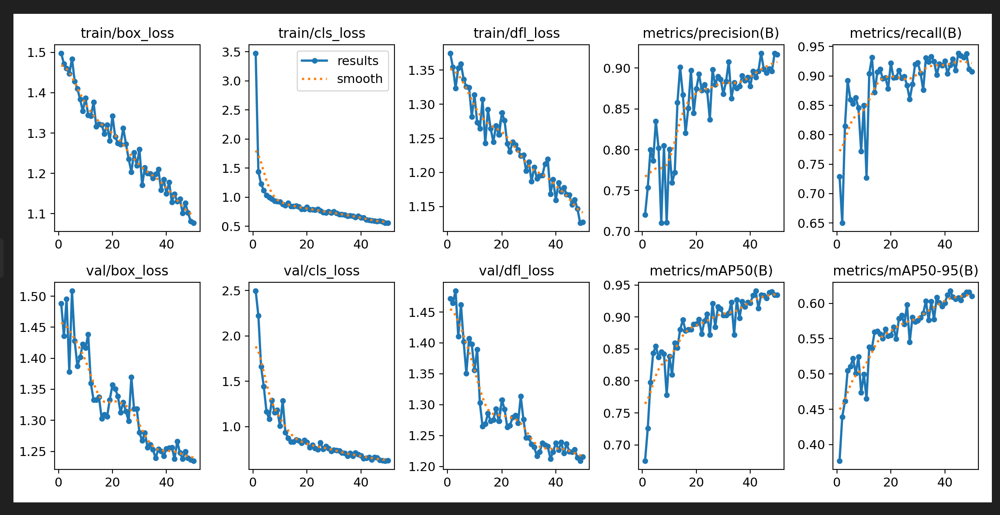
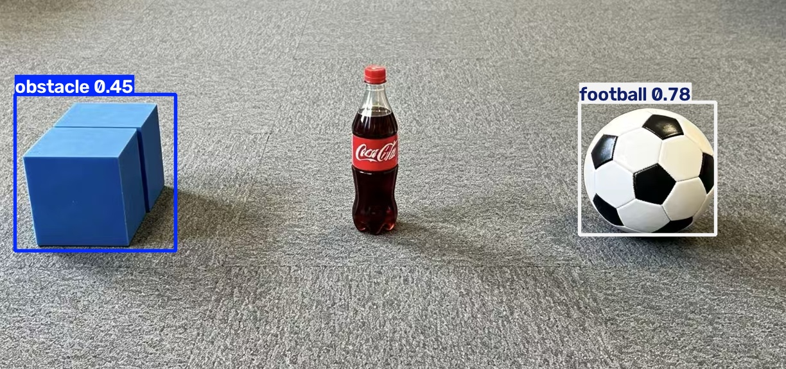

# yolo模型

基于 Ultralytics YOLO11n 的机器人场景目标检测工程实践。

- **学号**：202510201616
- **姓名**：胡宏任
- **班级**：无
- **项目名称**：yolo模型
- **提交日期**：2026-10-18

本项目使用 Ultralytics YOLO11n 完成机器人场景中 `obstacle`、`cola`、`football` 三类目标的
数据整理、人工标注、模型训练和新图片检测。仓库目录内包含完整代码、配置、数据集、训练结果、
推理结果和各阶段截图。

---

## 1. 检测类别

| 编号 | 类别 | 说明 |
|---|---|---|
| 0 | obstacle | 蓝色方块障碍物 |
| 1 | cola | 可乐瓶 |
| 2 | football | 足球 |

---

## 2. 项目成果

| 项目 | 结果 |
|---|---|
| 模型 | YOLO11n（`yolo11n.pt` 预训练微调） |
| 数据集 | 751 张（train 601 / val 150），824 个框 |
| 训练轮数 | 50 epochs |
| 图片尺寸 | 640 |
| batch | 16 |
| 训练设备 | NVIDIA RTX 5060 Laptop GPU（8 GB） |
| 训练用时 | 约 227 秒 |
| Precision（best.pt） | **0.889** |
| Recall（best.pt） | **0.918** |
| mAP50（best.pt） | **0.941** |
| mAP50-95（best.pt） | **0.618** |
| 最佳权重 | `runs/train_20261018_1701/weights/best.pt`（约 5.26 MB） |

分类别指标（best.pt 复验）：

| 类别 | Precision | Recall | mAP50 | mAP50-95 |
|---|---|---|---|---|
| obstacle | 0.684 | 0.888 | 0.887 | 0.592 |
| cola | 0.988 | 0.979 | 0.975 | 0.736 |
| football | 0.995 | 0.889 | 0.961 | 0.527 |



已完成 **Level 1 ~ Level 4**；Level 5（本地可视化页面）未完成。

---

## 3. 环境依赖

| 项目 | 版本/配置 |
|---|---|
| Python | 3.10.22（conda 环境 `yolo_task`） |
| PyTorch | 2.11.0 + CUDA 12.8 |
| Ultralytics | 8.4.180 |
| 标注工具 | labelImg 1.8.3 + PyQt5 5.15.11 |
| OpenCV | 5.0.0.93 |
| GPU | NVIDIA GeForce RTX 5060 Laptop GPU |
| OS | Windows |

安装依赖：

```bash
pip install -r requirements.txt
```

> 如果使用 GPU，torch 需要安装对应 CUDA 版本，例如：
> `pip install torch torchvision --index-url https://download.pytorch.org/whl/cu128`

---

## 4. 项目结构

```text
202510201616/
├─ README.md                    项目说明（本文件）
├─ report.md                    详细报告
├─ train.py                     训练脚本
├─ predict.py                   推理脚本
├─ data.yaml                    数据集配置
├─ requirements.txt             依赖清单
├─ dataset/                     751 张 YOLO 数据集
│  ├─ images/train|val
│  ├─ labels/train|val
│  ├─ classes.txt
│  ├─ dataset_split.csv         逐张划分清单
│  └─ README.md
├─ runs/
│  ├─ README.md
│  └─ train_20261018_1701/      训练结果（曲线、混淆矩阵、权重）
├─ results/
│  ├─ README.md
│  ├─ predict/                  推理结果样例
│  ├─ new_test/                 新图片测试（输入/结果/分析）
│  └─ screenshots/              各阶段截图（见 screenshots/README.md）
└─ .gitignore
```

---

## 5. 数据集

### 5.1 来源与整理

原始数据是仓库 `YOLO/obstacle|cola|football` 下的 949 张 640×480 JPEG：

- obstacle 316 张、cola 293 张、football 340 张；
- 初次下载缺的 28 张 cola 已按仓库 manifest 补齐，并逐张校验文件大小和可解码性；
- 人工标注完成 751 张（train 751/759，val 0/190）；
- 为了让训练集和验证集都有标签，取已标注的 751 张，按类别分层随机切 8:2，得到 601/150；
- 剩余 198 张（原 val 190 张 + 原 train 8 张漏标/空场景）没有放入本数据集。

### 5.2 数量

| split | images | labels | boxes | obstacle | cola | football |
|---|---|---|---|---|---|---|
| train | 601 | 601 | 662 | 262 | 189 | 211 |
| val | 150 | 150 | 162 | 61 | 47 | 54 |
| **合计** | **751** | **751** | **824** | **323** | **236** | **265** |

划分方式：按类别分层随机 8:2，随机种子 42；逐张清单见 `dataset/dataset_split.csv`。

### 5.3 结构

```text
dataset/
├─ images/
│  ├─ train/   601 张
│  └─ val/     150 张
└─ labels/
   ├─ train/   601 个 .txt
   └─ val/     150 个 .txt
```

图片和标签同名成对：`images/train/cola_0001.jpg` ↔ `labels/train/cola_0001.txt`。

### 5.4 标签格式

每行一个目标，格式为：

```text
类别id  中心x  中心y  宽  高
```

x/y/w/h 均为相对图片宽高的归一化值（0~1）。示例：

```text
1 0.489063 0.490625 0.068750 0.247917
```

### 5.5 data.yaml

```yaml
train: dataset/images/train
val: dataset/images/val

nc: 3
names:
  0: obstacle
  1: cola
  2: football
```

训练脚本会用 `data.yaml` 的绝对路径加载，因此 `train`/`val` 相对 `data.yaml` 所在目录解析。
已用 Ultralytics 实际加载验证：601 train / 150 val，0 corrupt、0 background。

---

## 6. 数据标注

- 工具：labelImg 1.8.3；
- 格式：YOLO（直接保存 `.txt`，不需要从 `.xml` 转换）；
- 类别：`0 obstacle / 1 cola / 2 football`；
- 共 751 个标签文件、824 个框；
- 每张图片都有同名 `.txt`，没有空标签；
- 标签格式检查通过：类别编号 0~2、坐标 0~1、无宽高为 0 的框。

标注界面、标注样例和标签统计见：

- `results/screenshots/02_labelImg标注界面.png`
- `results/screenshots/15_标注样例_12张.jpg`
- `results/screenshots/03_标注进度检查.png`

---

## 7. 模型训练

```bash
python train.py
```

训练参数：

| 参数 | 值 |
|---|---|
| model | `yolo11n.pt`（首次运行自动下载） |
| data | `data.yaml` |
| epochs | 50 |
| imgsz | 640 |
| batch | 16 |
| device | GPU 0 |
| optimizer | AdamW（auto） |
| seed | 0 |

结果目录：

```text
runs/train_20261018_1701/
├─ weights/best.pt       最佳权重（5,520,209 bytes）
├─ weights/last.pt
├─ results.png           Loss / Precision / Recall / mAP 曲线
├─ results.csv           每个 epoch 的原始指标
├─ confusion_matrix.png / confusion_matrix_normalized.png
├─ BoxPR_curve.png / BoxF1_curve.png / BoxP_curve.png / BoxR_curve.png
├─ train_batch*.jpg
├─ val_batch*_labels.jpg / val_batch*_pred.jpg
└─ args.yaml
```

best.pt 复验指标：P 0.889 / R 0.918 / mAP50 0.941 / mAP50-95 0.618。

训练过程、结果目录、曲线和权重信息截图：

- `results/screenshots/05_训练启动_数据与GPU.png`
- `results/screenshots/06_训练开始_epoch进度.png`
- `results/screenshots/07_训练完成_指标与权重.png`
- `results/screenshots/08_训练曲线_results.png`
- `results/screenshots/09_混淆矩阵.png`
- `results/screenshots/13_PR曲线.png`、`results/screenshots/14_F1曲线.png`

---

## 8. 新图片推理

```bash
python predict.py --source 图片或文件夹
```

默认加载 `runs/train_20261018_1701/weights/best.pt`（`predict.py` 会自动找最新的 run），
结果保存到 `results/predict/`，图中显示框、类别、置信度。

### 8.1 验证集外图片

`results/predict/` 中放了 12 张验证集代表样例（cola / football / obstacle 各 4 张），
另外还有 3 张后来补的独立新图结果（`new_test_01~03`，说明见 `results/predict/README_新增.md`）。
完整 190 张验证集结果在本地工作目录。拼图见 `results/screenshots/16_预测样例_8张.jpg`。

### 8.2 独立新图片测试

`results/new_test/` 是一张完全独立的新图（1224×576：蓝方块 + 红标可乐瓶 + 足球）：

| 目标 | 结果 | 置信度 |
|---|---|---|
| football | ✅ | 0.78 |
| obstacle | ✅ | 0.45 |
| cola | ❌ 漏检 | — |

3 个目标检出 2 个。详细分析见 `results/new_test/README.md`：
训练集的 cola 主要是深色瓶身，这张是透明瓶身 + 红色标签，属于训练分布外；
单独裁剪时模型只对瓶身下半段深色液体有 0.56 响应，整图漏检。
COCO 预训练模型在同一张图上能检出 `bottle 0.87` / `sports ball 0.79`，说明目标本身清晰，
是模型对新外观泛化不足。



---

## 9. 提交要求对照

| 提交要求 | 对应文件 |
|---|---|
| 1. 模型正常开始训练的终端截图 | `results/screenshots/05_训练启动_数据与GPU.png`、`results/screenshots/06_训练开始_epoch进度.png` |
| 2. 训练完成后的结果目录 | `runs/train_20261018_1701/`（文件清单见其中 `run_files.txt`） |
| 3. Loss、Precision、Recall 等结果图 | `results/screenshots/08_训练曲线_results.png`、`runs/.../results.png`、`results.csv` |
| 4. 模型权重文件信息 | `results/screenshots/07_训练完成_指标与权重.png`、`runs/.../weights/best.pt` |
| 5. 使用训练模型完成验证/测试 | `results/screenshots/10_新图片推理终端.png`、`results/screenshots/11_新图片检测结果.png`、`results/predict/`、`results/new_test/` |

更详细的报告见 [report.md](report.md)。

---

## 10. 遇到的问题与解决

1. **原始数据缺 28 张 cola**
   初次下载不完整，按仓库 manifest 重新下载并校验文件大小，949 张全部可解码。

2. **val 190 张没有标注**
   标注时 labelImg 打开的是 train，val 一张都没标；train 还有 8 张漏标。
   为了让数据集可以直接训练且有可信的 mAP，取已标注的 751 张重新分层 8:2（601/150）。

3. **labelImg 在 PyQt5 5.15 下崩溃**
   - 滚轮滚动：`QScrollBar.setValue()` 收到 float，抛 `TypeError`；
   - 画框模式十字辅助线：`QPainter.drawLine()` 收到 float，抛 `TypeError`；
   - 拖框矩形和框上类别文字也有同类问题。
   在标注启动器里对 `scrollRequest` / `zoomRequest` / `setZoom` 和 `Canvas.paintEvent` /
   `Shape.paint` 做了兼容补丁（统一转 int / 用 QLineF、QRectF），并加了离屏自检。

4. **中文路径**
   项目路径包含中文，`data.yaml` 统一使用 `/` 分隔的绝对路径/相对路径，
   并实际用 Ultralytics 加载验证。

5. **标注质量**
   抽查发现部分图片只框了主目标，个别图有第二个同类目标未框（例如一张图两个蓝方块只框一个）；
   有 15 张图的“主类别”没有出现在标签里（13 张 football 图只框了蓝方块，
   `obstacle_0138/0139` 只框了远处小球）。这不影响训练跑通，但会带来漏检/指标偏乐观。

---

## 11. 说明

- Level 5（本地图片识别页面）没有完成，本仓库覆盖 Level 1~4。
- 数据集使用随机分层划分，相邻视频帧相似度较高，val 指标会偏乐观；报告里已说明划分方式。
- `runs/.../args.yaml` 里记录的是训练时本机的绝对路径，仅作参数记录；
  重新运行时请以当前目录的 `data.yaml` 为准。
- 原始 949 张图片没有全部放入本目录，只放入了实际用于训练的 751 张；
  `dataset/dataset_split.csv` 记录了每张图的来源和划分。
