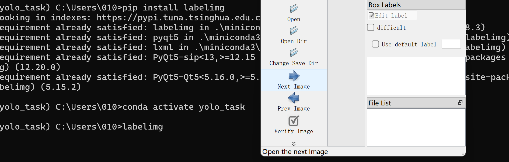
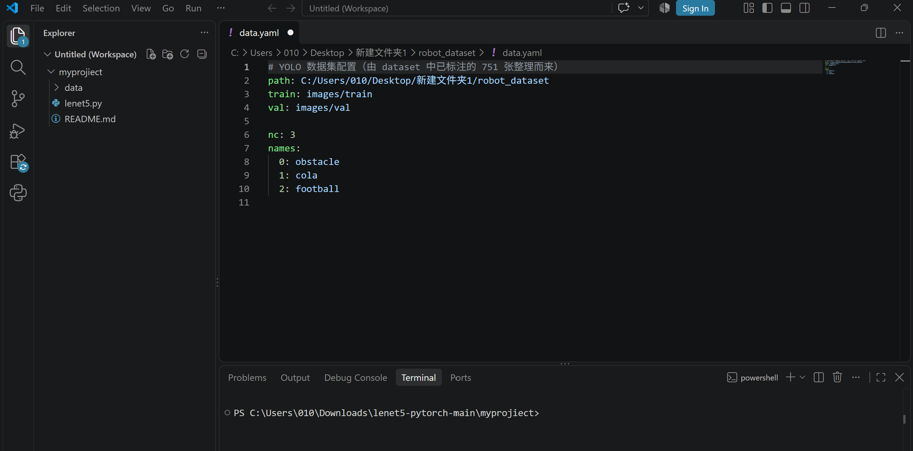
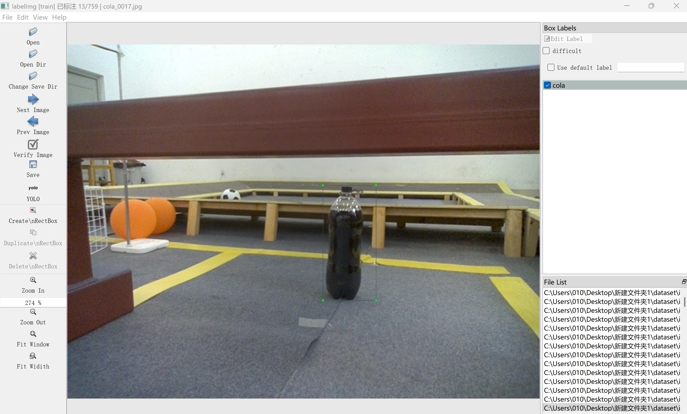
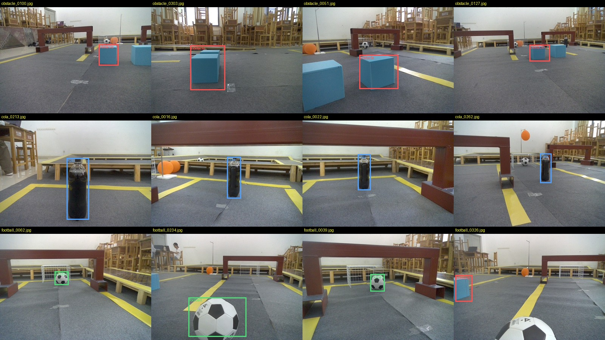
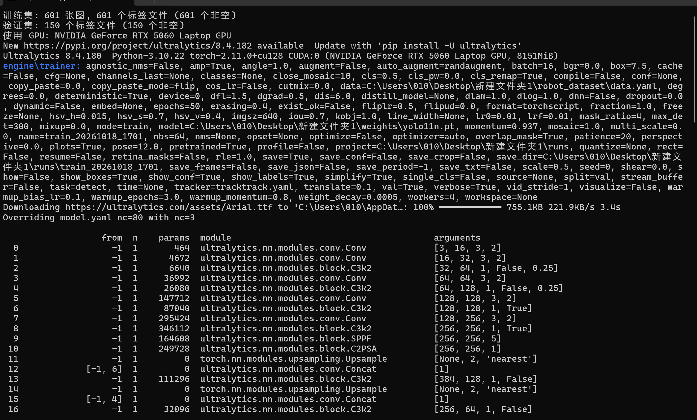
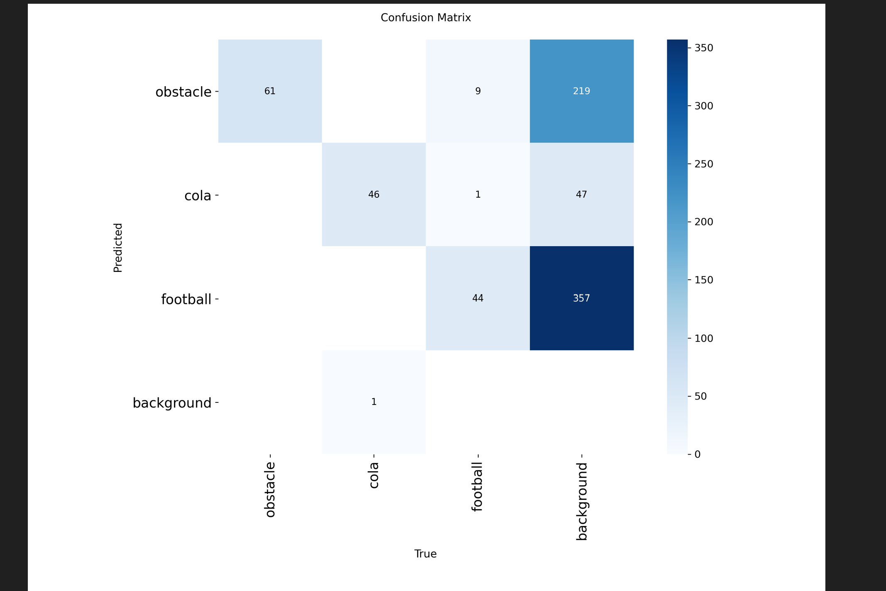
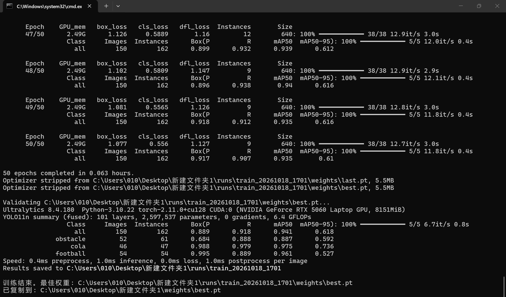

# yolo模型 考核报告

- **学号**：202510201616
- **姓名**：胡宏任
- **班级**：无
- **项目名称**：yolo模型
- **提交日期**：2026-10-18

---

## 一、实验背景与目的

本项目围绕机器人场景中的 `obstacle`（蓝色方块障碍物）、`cola`（可乐瓶）、
`football`（足球）三类目标，完成一次完整的目标检测工程实践：

1. 配置 Python / PyTorch / Ultralytics YOLO 环境；
2. 整理实验室提供的三类原始图片，检查数量、格式、分辨率；
3. 使用 labelImg 完成人工标注，并整理成 YOLO 数据集格式；
4. 使用 YOLO11n 训练模型，查看 Loss、Precision、Recall、mAP；
5. 使用训练得到的 `best.pt` 对新图片做检测，保存带框、类别、置信度的结果图。

本项目的重点不是从零实现 YOLO，而是掌握“数据整理 → 标注 → 训练 → 推理”的完整流程。

---

## 二、Level 1：环境配置与数据集整理

### 2.1 环境配置

| 项目 | 配置 |
|---|---|
| Python | 3.10.22（conda 环境 `yolo_task`） |
| PyTorch | 2.11.0 + CUDA 12.8 |
| Ultralytics | 8.4.180 |
| labelImg | 1.8.3 + PyQt5 5.15.11 |
| OpenCV | 5.0.0.93 |
| GPU | NVIDIA GeForce RTX 5060 Laptop GPU（8 GB） |
| 操作系统 | Windows |

环境安装和 labelImg 启动截图见 `results/screenshots/01_环境与labelImg启动.png`。



### 2.2 原始数据检查

仓库 `YOLO/` 下提供三类原始图片，共 **949 张**：

| 类别 | 张数 |
|---|---|
| obstacle | 316 |
| cola | 293 |
| football | 340 |
| **合计** | **949** |

图片基本都是 640×480 JPEG（948 张 640×480，1 张 640×400）。

整理时发现初次下载缺了 **28 张 cola**，于是按仓库 `manifest.json` 重新下载，
并逐张校验文件大小、可解码性；最终 949 张全部可正常打开。

### 2.3 数据集划分

原始数据的计划是 759 张 train、190 张 val。实际标注完成后核对发现：

- train：751/759 张有标签，少 8 张（6 张是空场景/没有目标，2 张有明显 cola 但漏标）；
- val：**0/190 张有标签**（标注时 labelImg 打开的是 train，val 没有标）。

如果直接按 759/190 训练，val 没有标签，mAP 会一直是 0。
因此我从**已经标好的 751 张**里，按类别分层随机重新切 8:2（随机种子 42），得到：

| split | images | labels | boxes | obstacle | cola | football |
|---|---|---|---|---|---|---|
| train | 601 | 601 | 662 | 262 | 189 | 211 |
| val | 150 | 150 | 162 | 61 | 47 | 54 |
| **合计** | **751** | **751** | **824** | **323** | **236** | **265** |

剩下的 198 张（原 val 190 + 原 train 8 张）没有放进训练数据集。
每张图的来源、train/val、类别、框数记录在 `dataset/dataset_split.csv`。

### 2.4 数据集目录

```text
dataset/
├─ images/
│  ├─ train/   601 张 .jpg
│  └─ val/     150 张 .jpg
└─ labels/
   ├─ train/   601 个 .txt
   └─ val/     150 个 .txt
```

图片与标签同名成对，例如：

```text
dataset/images/train/cola_0001.jpg
dataset/labels/train/cola_0001.txt
```

### 2.5 data.yaml

```yaml
train: dataset/images/train
val: dataset/images/val

nc: 3
names:
  0: obstacle
  1: cola
  2: football
```

截图见 `results/screenshots/04_data_yaml配置.png`。用 Ultralytics 实际加载验证过：
train 601 张、val 150 张，0 corrupt、0 background。



> 截图是本地运行时版本（`path` 为绝对路径）；仓库里的 `data.yaml` 改成了相对路径
> `dataset/images/train`、`dataset/images/val`，内容等价，换机器也能用。

---

## 三、Level 2：数据标注

### 3.1 标注工具与流程

使用 **labelImg 1.8.3**，启动时强制 YOLO 格式（直接保存 `.txt`，不是 PascalVOC 的 XML）：

1. 打开 `dataset/images/train`；
2. 标签保存目录设为 `dataset/labels/train`；
3. 按 `W` 画框，选择类别，`D` 下一张（开启自动保存）；
4. 类别列表固定为 `obstacle / cola / football`，只允许这三个值。

标注界面截图：`results/screenshots/02_labelImg标注界面.png`。



### 3.2 类别与标签格式

类别编号：

| 编号 | 类别 |
|---|---|
| 0 | obstacle |
| 1 | cola |
| 2 | football |

每个 `.txt` 每行一个目标：

```text
类别id  中心x  中心y  宽  高
```

坐标是相对图片宽高的归一化值（0~1）。示例：

```text
1 0.489063 0.490625 0.068750 0.247917
```

表示：cola（1），中心在图片宽度 48.9%、高度 49.1% 处，框宽 6.875%、高 24.79%。

### 3.3 标注数量与检查

- 751 个标签文件、824 个框；
- 每张图片都有同名 `.txt`，没有空标签；
- 类别编号都在 0~2，坐标都在 0~1，没有宽/高为 0 的框；
- 每个类别的框数：obstacle 323、cola 236、football 265。

标注进度和标注样例：

- `results/screenshots/03_标注进度检查.png`
- `results/screenshots/15_标注样例_12张.jpg`



### 3.4 标注过程中遇到的问题

labelImg 1.8.3 在 PyQt5 5.15 下有若干旧代码兼容问题：

1. 鼠标滚轮滚动时，`QScrollBar.setValue()` 收到 float，抛 `TypeError`，进程退出；
2. 画框模式下绘制十字辅助线时，`QPainter.drawLine()` 收到 float，抛 `TypeError`；
3. 拖拽画框矩形、在框上显示类别文字也有同类问题。

解决方式：在标注启动器里对 `scrollRequest`、`zoomRequest`、`setZoom`、
`Canvas.paintEvent`、`Shape.paint` 打兼容补丁（统一转 int，或用 `QLineF`/`QRectF`/`QPointF`），
并加了离屏自检覆盖滚动、缩放、十字线、模拟拖框和保存标签。

---

## 四、Level 3：模型训练

### 4.1 训练配置

```bash
python train.py
```

| 参数 | 值 |
|---|---|
| 模型 | `yolo11n.pt`（YOLO11n） |
| 数据 | `data.yaml`（601 train / 150 val） |
| epochs | 50 |
| imgsz | 640 |
| batch | 16 |
| device | GPU 0（RTX 5060 Laptop） |
| optimizer | AdamW（auto） |
| seed | 0 |
| workers | 4 |

训练启动截图：

- `results/screenshots/05_训练启动_数据与GPU.png`（601/150 张、GPU、Ultralytics 参数）
- `results/screenshots/06_训练开始_epoch进度.png`（50 epochs 开始、前几个 epoch 的 loss/mAP）



### 4.2 训练过程

50 epochs 用时约 **227 秒**。训练过程中：

- train/box_loss 从约 1.50 降到 1.08；
- train/cls_loss 从约 3.5 快速降到 0.56；
- train/dfl_loss 从约 1.37 降到 1.13；
- val/box_loss 从约 1.50 降到 1.23；
- Precision、Recall、mAP50 在 10 个 epoch 内快速上升，之后趋于稳定。

曲线见 `results/screenshots/08_训练曲线_results.png`，原始文件 `runs/train_20261018_1701/results.png`；
原始数值 `results.csv`。


### 4.3 训练结果

训练结束后对 `best.pt` 复验：

| class | images | instances | Precision | Recall | mAP50 | mAP50-95 |
|---|---|---|---|---|---|---|
| all | 150 | 162 | 0.889 | 0.918 | **0.941** | **0.618** |
| obstacle | 52 | 61 | 0.684 | 0.888 | 0.887 | 0.592 |
| cola | 46 | 47 | 0.988 | 0.979 | 0.975 | 0.736 |
| football | 54 | 54 | 0.995 | 0.889 | 0.961 | 0.527 |

> 说明：`results.csv` 最后一轮记录的是 last.pt 的指标（P 0.9168 / R 0.9073 /
> mAP50 0.9349 / mAP50-95 0.6101）；上面表格是训练结束后对 best.pt 的复验结果。

混淆矩阵、PR 曲线、F1 曲线：

- `results/screenshots/09_混淆矩阵.png`
- `results/screenshots/13_PR曲线.png`
- `results/screenshots/14_F1曲线.png`
- 原始文件都在 `runs/train_20261018_1701/` 下。



### 4.4 权重文件

| 文件 | 大小 |
|---|---|
| `runs/train_20261018_1701/weights/best.pt` | 5,520,209 bytes（约 5.26 MB） |
| `runs/train_20261018_1701/weights/last.pt` | 5,520,209 bytes |

权重信息截图：`results/screenshots/07_训练完成_指标与权重.png`。
训练完成后的结果目录：`runs/train_20261018_1701/`，文件清单见其中的 `run_files.txt`。



---

## 五、Level 4：新图片检测

### 5.1 推理方式

```bash
python predict.py --source 新图片或文件夹
```

默认加载 `runs/train_20261018_1701/weights/best.pt`（`predict.py` 会自动找最新的 run），
结果保存在 `results/predict/`，每张图显示：
目标框、类别名称、置信度。

### 5.2 验证集外的图片

`dataset/images/val` 之外还有 190 张原始 val 图片没有参与 robot_dataset 的训练/验证，
可以当作“新图片”。用 best.pt 对这批图推理，得到 190 张检测结果（本地工作目录）。
仓库 `results/predict/` 中放了 12 张代表样例（每个类别 4 张），拼图见
`results/screenshots/16_预测样例_8张.jpg`。
另外还有 3 张后来补充的独立新图结果（`new_test_01~03`），说明见
`results/predict/README_新增.md`。

终端推理输出截图：`results/screenshots/10_新图片推理终端.png`。

### 5.3 独立新图片测试

另外用一张完全独立的新图片测试（1224×576，左侧蓝方块、中间红标可口可乐瓶、右侧足球）：

| 目标 | 结果 | 置信度 |
|---|---|---|
| football | ✅ 检出 | 0.78 |
| obstacle | ✅ 检出 | 0.45 |
| cola | ❌ 漏检 | — |

结果图：`results/screenshots/11_新图片检测结果.png`、`results/screenshots/17_新图片检测_高清.jpg`；
输入和详细分析在 `results/new_test/`。


**cola 漏检原因分析：**

- 训练集里的 cola 基本是**深色瓶身**的可乐瓶，场景是机器人比赛场地；
- 测试图是**透明瓶身 + 红色标签**的可口可乐塑料瓶，灰色地毯背景；
- 两者外观、颜色、上下文差异大，属于训练分布外（domain gap）；
- conf 降到 0.05 仍无 cola；imgsz 960/1280 时出现把足球误判成 cola 的误检，不可靠；
- 单独紧裁瓶子时，模型只对瓶身下半段深色液体有 0.56 响应，框不完整；
- 用 COCO 预训练的 `yolo11n.pt` 在同一张图上能检出 `bottle 0.87`、`sports ball 0.79`，
  说明目标本身清晰，是模型对新外观泛化不足。

**改进方向：** 补 30~50 张这种红标可乐瓶（不同角度、不同背景）加入训练集重新训练/微调；
只调置信度阈值解决不了。

---

## 六、遇到的问题与解决

| 问题 | 现象 | 解决 |
|---|---|---|
| 原始数据缺 28 张 cola | 初次下载不完整 | 按 manifest 重新下载，逐张校验大小/可解码性 |
| val 190 张没标注 | 训练时 mAP 会一直是 0 | 用已标注的 751 张重新分层 8:2（601/150） |
| labelImg 滚轮崩溃 | `QScrollBar.setValue()` 收到 float | 启动器里 `scrollRequest` 转 int |
| labelImg 画框十字线崩溃 | `QPainter.drawLine()` 收到 float | `Canvas.paintEvent` 改用 `QLineF` |
| labelImg 拖框矩形/文字崩溃 | `drawRect`/`drawText` 收到 float | 改用 `QRectF`/`QPointF` |
| 中文路径 | `data.yaml` 路径解析 | 统一使用 `/`，并实际加载验证 |
| 标注漏框 | 部分图第二个同类目标未框；15 张主类别未出现在标签 | 记录在 README，建议后续补标 |

---

## 七、总结与反思

通过这次实践，我完整走了一遍目标检测的工程流程：

1. 学会了用 conda 管理环境、安装 PyTorch/Ultralytics/labelImg；
2. 理解了 YOLO 标签格式（类别 + 归一化中心点/宽高）和数据集目录规范；
3. 完成了 751 张图片的人工标注，处理了数据缺失、val 未标注等问题；
4. 用 YOLO11n 在 GPU 上完成 50 epochs 训练，mAP50 达到 0.941；
5. 用 best.pt 对新图片推理，能正确检出 obstacle 和 football；
6. 通过红标可乐瓶漏检的案例，认识到训练数据外观覆盖对泛化能力的影响。

不足之处：

- Level 5（本地可视化页面）没有完成；
- 标注以“每张图主目标”为主，部分图片存在漏框，指标会偏乐观；
- 数据集随机划分，相邻视频帧相似度高，val 指标偏乐观；
- 对新外观（红标可乐瓶）泛化不足，需要补充数据。

后续计划：学习 Streamlit/Gradio 完成 Level 5；补充红标可乐瓶等新外观数据；
尝试按拍摄时段划分数据集，做更严格的泛化评估。

---

## 八、附录：文件与截图清单

| 内容 | 文件 |
|---|---|
| 项目说明 | `README.md` |
| 详细报告 | `report.md` |
| 训练脚本 | `train.py` |
| 推理脚本 | `predict.py` |
| 数据配置 | `data.yaml` |
| 数据集 | `dataset/`（751 张，601/150） |
| 划分清单 | `dataset/dataset_split.csv` |
| 训练结果 | `runs/train_20261018_1701/` |
| 最佳权重 | `runs/train_20261018_1701/weights/best.pt` |
| 推理样例 | `results/predict/`（12 张验证集样例 + 3 张补充新图） |
| 新图测试 | `results/new_test/` |
| 各阶段截图 | `results/screenshots/`（编号 01~17，见 `results/screenshots/README.md`） |
